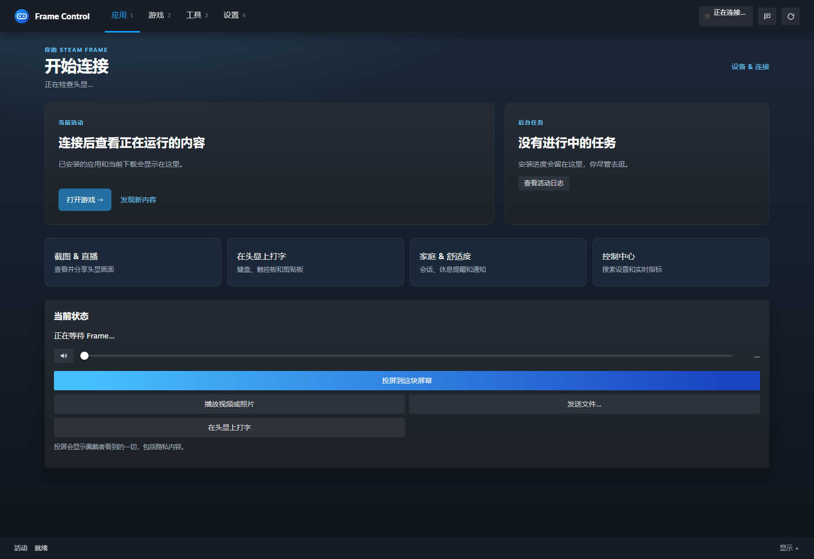

<div align="center">


<a id="frame-control"></a>

# Frame Control

**在电脑上管理你的 Valve Steam Frame。**<br>
看头显镜头里看到的画面，安装游戏和 Android 应用，在两边互传文件和文字，查看电池与状态——全程走 SSH。

**这是 [saphid/frame-control](https://github.com/saphid/frame-control) 的简体中文分支，界面文案已全部汉化。**<br>
[English README](README.en.md) · [汉化说明：汉化了什么、没汉化什么、怎么跟进上游](LOCALIZATION.md) · [上游仓库](https://github.com/saphid/frame-control)

[](https://github.com/saphid/frame-control/releases/latest)
[](#install)
[](https://github.com/saphid/frame-control/actions/workflows/checks.yml)
[](LICENSE)

[**官网**](https://framecontrol.fun) · [**下载**](#install) · [预告片](#trailer) · [功能](#features) · [设置头显](#set-up-the-headset) · [反馈](#feedback) · [文档](#going-further)

<br>


<br>
<sub>中文界面（截图时还没连上头显，所以状态显示为正在连接）。</sub>

<a id="trailer"></a>
<a href="https://github.com/saphid/frame-control/releases/download/trailer/frame-control-trailer.mp4"></a>

<sub>预告片：66 秒，带声音。MP4 从 trailer 那次 release 下载。</sub>

<sub>非官方业余项目，与 Valve 没有隶属关系。免费且开源。</sub>

[看看哪些功能在真实 Frame 上测过、在虚拟机里测过，或者只跑过自动化检查](docs/current-support-matrix.md)。

</div>

---

<a id="features"></a>

## 功能

<table>
<tr>
<td width="50%" valign="top">

**👓 头显画面与桌面**<br>
镜头里看到的实时画面，或正在使用中的应用面板，无论佩戴者怎么四处张望，都平整稳定。打开“控制”后，可以直接在画面上点按或点击，用手机或电脑操作 Frame。

</td>
<td width="50%" valign="top">

**🔋 电池与状态**<br>
当前电量、充电功率与剩余时间、存储、内存、温度、Wi-Fi，以及正在运行的东西。

想查电脑这一侧的 USB、驱动、无线模块和网络管理器证据，用
[Linux 无线适配器诊断](docs/linux-wireless-adapter-doctor.md)。

要做可重复的只读电池、供电轨、温度和风扇测量，
用[功耗与发热采样](docs/power-and-heat.md)。

</td>
</tr>
<tr>
<td valign="top">

**🎮 Steam 游戏**<br>
你拥有的每个游戏，附带它的 Steam Frame 评级。安装到头显上并显示实时进度；按筛选条件、价格和游戏详情浏览和搜索 Steam 商店目录；也能强制退出卡死的游戏。

</td>
<td valign="top">

**🤖 Android 应用**<br>
约 4,500 个按 Frame 评过级的 F-Droid 应用。一键安装，每个都作为独立应用进入你的 Steam 库。

</td>
</tr>
<tr>
<td valign="top">

**📁 文件与游戏**<br>
把文件拖到窗口上就发送过去。把游戏的 .zip、文件夹或 .exe 拖进来，就会加进 Steam 库，并自动替你选好 Proton 还是 Linux 运行时。

</td>
<td valign="top">

**📸 截图与录制**<br>
浏览你在头显里拍的截图并存到“图片”文件夹，也可以让新截图和你的 Steam 片段自动拷过来。录制 SteamVR 镜像的头显画面（带声音），或把 Steam 的片段按任意长度导出为 .mp4，放进“视频”文件夹。[录制细节与透视限制](docs/recording.md#does-record-include-passthrough)。

**⌨️ 键盘与触控板**<br>
用电脑或手机在头显里打字、控制指针，走的是 Valve 自己的输入通道，什么都不用装。变音符号和 emoji 走 KDE Connect，Frame Control 自带它，第一次输入这类字符时会自动配好。可以把文字复制到头显剪贴板，也能反过来取回。Ctrl、Alt、Shift、Super 和特殊键有明确的转发规则，还会给被电脑截走的按键提供快捷键菜单。按 T 打开它。[支持的按键与测试范围](docs/keyboard-input.md)。

</td>
</tr>
<tr>
<td valign="top">

**🧩 Flatpak 与显示**<br>
安装 Moonlight、VLC 这类桌面应用，并为每个 Android 应用单独设置分辨率和文字大小。

</td>
<td valign="top">

**⚡ 一键工具**<br>
SSH、SFTP、Steam Link、远程桌面、音量、睡眠、重启和关机。

</td>
</tr>
<tr>
<td colspan="2" valign="top">

**💾 备份与恢复**<br>
把游戏存档、设置和 Android 应用数据拷到电脑，恢复出厂设置之后再还原回来。登录文件和密钥一律不拷。头显卡在桌面模式时，“返回游戏模式”按钮能救急。尚未在头显上测试。[工作原理](docs/backup-and-recovery.md)。

</td>
</tr>
</table>

可选的[家庭与舒适度](docs/family-comfort.md)卡片提供会话时长限制、休息提醒、本地提醒和一键投屏。一次会话会往你在头显上的用户账号里复制一个小小的 Frame Control worker。

其余功能不会在 Frame 上安装任何东西：应用只用 SteamOS 已经自带的东西（侧载游戏会把 Valve 自己的 devkit 脚本复制到 `~/devkit-utils`，和 Valve 的 Devkit Client 做法一样）。可选的[性能 HUD](docs/vr-utilities.md) 会把我们自己的 Python 小工具复制到 `~/.local/share/frame-control/vr/`。[每个功能是怎么实现的](docs/frame-control.md)。

<a id="install"></a>

## 安装

**Frame Control 装在电脑上，不是装在头显里。**官网只提供下载和说明，它不会在浏览器里连接你的 Frame。按你要用的那台电脑的操作系统和处理器来选。

### 本中文分支怎么装

这个分支是**源码汉化版**，本仓库不提供预编译安装包。上游的安装包（下一节那张表）装出来是**英文界面**。想要中文界面，目前有两条路：

**1. 直接跑本地 Web 界面（最省事，Windows / macOS / Linux 通用）**

```sh
git clone https://github.com/dhies23/frame-control-zh.git
cd frame-control-zh
python ui/server.py --port 47810
```

然后用浏览器打开 `http://127.0.0.1:47810`。要求：Python 3.9 或更新、系统里有 `ssh`（Windows 用自带的 OpenSSH Client），头显已开开发者模式并设好密码。界面和桌面应用里的完全一样，只是外面少了窗口外壳；关闭终端就等于退出。

**2. 自己构建桌面应用**

```sh
cd app
npm install
npm start
```

需要 Node.js 20 以上。`npm start` 会走 `app/build/fetch-deps.js` 打包依赖，另外还有 `npm run dist:win` / `dist:linux` / `dist:mac` 可以出安装包。这条路依赖 electron-builder 的网络下载，本分支没有在 CI 里验证过。

两条路用的是同一套 `ui/` 界面文件，所以中文界面效果一致。

### 上游官方安装包（英文界面）

下面是上游项目的下载表，装出来是英文界面；想用中文请按上面两种方式之一运行本仓库的源码。想用英文原版，也可以直接装这些。

| | 下载 | 需要 |
|---|---|---|
| **macOS**（Apple Silicon） | [Frame-Control-mac-arm64.dmg](https://github.com/saphid/frame-control/releases/latest/download/Frame-Control-mac-arm64.dmg) | 无需额外组件 |
| **macOS**（Intel，v0.4.39+） | [Frame-Control-mac-x64.dmg](https://github.com/saphid/frame-control/releases/latest/download/Frame-Control-mac-x64.dmg) | 无需额外组件 |
| **Windows** 10 / 11（x64） | [Frame-Control-Setup-x64.exe](https://github.com/saphid/frame-control/releases/latest/download/Frame-Control-Setup-x64.exe) · [portable .zip](https://github.com/saphid/frame-control/releases/latest/download/Frame-Control-win-x64.zip) | OpenSSH Client（通常已装） |
| **Linux**（x64） | [AppImage](https://github.com/saphid/frame-control/releases/latest/download/Frame-Control-linux-x86_64.AppImage) · [.deb](https://github.com/saphid/frame-control/releases/latest/download/Frame-Control-linux-amd64.deb) | `ssh`（大多数桌面系统自带） |
| **Linux**（arm64） | [AppImage](https://github.com/saphid/frame-control/releases/latest/download/Frame-Control-linux-arm64.AppImage) · [.deb](https://github.com/saphid/frame-control/releases/latest/download/Frame-Control-linux-arm64.deb) | `ssh`；Android 应用还需要 `adb`（`sudo apt install adb`） |

<a id="is-it-safe-check-your-download"></a>

### 安全吗？校验你的下载

从 **v0.4.26** 起，安装包和 [SHA256SUMS](https://github.com/saphid/frame-control/releases/latest/download/SHA256SUMS) 要从**同一个 release** 取。更早的版本没有这个文件。SHA-256 对得上，说明你的文件就是那次发布的那个资产，但这并不证明应用里没有恶意代码。对你下载的文件运行下面的命令，然后把全部 64 个字符和 `SHA256SUMS` 里对应那一行逐个比对：

```powershell
# Windows PowerShell
Get-FileHash .\Frame-Control-Setup-x64.exe -Algorithm SHA256
```

```sh
# macOS: shasum -a 256 Frame-Control-mac-arm64.dmg
# Linux: sha256sum Frame-Control-linux-x86_64.AppImage
```

[源代码](https://github.com/saphid/frame-control)和[发布构建工作流](.github/workflows/release.yml)都是公开的。Windows 安装包**没有代码签名**，所以 SmartScreen 可能报警。macOS 应用只有 **ad hoc 签名**，没有 Apple Developer ID 签名；DMG **未签名也未公证**，所以 Gatekeeper 可能提示，也可能直接拦下。只有在你信任这份下载时，才按下面的打开步骤操作。

日本語: 请参考[5 步连接指南](docs/connection-faq.md#日本語-5-ステップで接続)。v0.4.26 及以后，请把文件的 SHA-256 与官方 release 的 SHA256SUMS 核对。Windows 版未签名，macOS 版没有开发者 ID 签名与公证。

**该下哪个构建？**Mac 上看苹果菜单 → 关于本机：Apple Silicon（M 系列）用 `mac-arm64`，Intel 用 `mac-x64`（v0.4.39 起提供）。Windows 上看设置 → 系统 → 关于 → 系统类型：发布的是 x64 构建，不是 Windows ARM 原生构建。Linux 上 `uname -m` 会显示 `x86_64`（x64）或 `aarch64`（arm64）。Debian/Ubuntu 用 `.deb`，其他发行版用 AppImage。

**iPhone 和 iPad：**[加入公开的 TestFlight 测试](https://testflight.apple.com/join/9xjW91g6)。你需要一台能连上的 Steam Frame，已开启开发者模式并设好开发者模式密码。配对之后，不用电脑，直接从手机就能用。要从 [`ios/`](ios) 自行构建，请在 Mac 上用 Xcode 和你自己的签名团队；见 [iPhone 指南](docs/iphone.md)。

应用自带 Python 和 `adb`。macOS 自带 SSH；Windows 需要装 OpenSSH Client 可选功能（通常已经装好）。从 0.4 起它会自己更新：有新版本发布时，横幅会提示**更新并重启**。它会发送匿名使用统计，你可以关掉。共享兼容性结果和错误详情需要你主动选择加入。见 [docs/privacy.md](docs/privacy.md)。Google 不为 arm64 Linux 发布 `adb`，所以那个构建用你发行版自带的。如果你自己已经装了 `adb`，应用就用你的。

<details>
<summary><b>macOS：这个应用没有公证</b></summary>

应用只有 **ad hoc 签名**，没有 Apple Developer ID 签名，也没有公证。DMG 是未签名的。先用同一个 release 的 `SHA256SUMS` 校验下载，再打开 DMG，把 **Frame Control** 拖到**应用程序**。

打开前先确认你的处理器：v0.4.38 及更早只为 Apple Silicon 发布 `mac-arm64`。在 Intel Mac 上这个构建跑不起来；去掉隔离标记或者装 Rosetta，都不能让 ARM 应用在 Intel 上运行。在一台真实的 Intel MacBook Air（macOS 15.7.7）上，打开 v0.4.35 和 v0.4.36 报的是：**“The application cannot be opened because it has an incorrect executable format.”** 这是架构不匹配导致的失败，不是观察到的 Gatekeeper 警告。之后官方 **v0.4.39 Intel DMG** 在那台 Air 上通过了校验、安装并成功启动。CLI 和 T3 浏览器两条下载路径得到的文件都没有隔离属性；没有出现 Gatekeeper 对话框，而 `spctl` 会拒绝这个 ad hoc 签名的应用。这并没有验证 Safari/Chrome 的警告，也没有验证“仍要打开”。见[已发布的 Intel 测试](docs/evidence/mac-v0439-2026-10-26.md)和[更早的架构失败](docs/evidence/mac-desktop-2026-10-26.md)。

在兼容的 Mac 上，如果 macOS 拦下了未验证的开发者，先试着打开一次应用，然后到**系统设置 → 隐私与安全性 → 仍要打开**，确认**打开**。只对你校验过、也信任的下载这么做。[Apple 的打开说明](https://support.apple.com/102445)描述了当前的安全机制。具体的警告文案和这套绕过流程，在两种 Mac 架构上都还没有在本项目里验证过。

如果一份可信、校验过的副本仍然报“已损坏”，也没有“仍要打开”的选项，可以用终端兜底，它只会去掉这个应用的下载隔离标记（不会给应用签名或公证）：

```sh
xattr -dr com.apple.quarantine "/Applications/Frame Control.app"
```

然后从“应用程序”里打开它。不要全局关闭 Gatekeeper。取决于你用到的功能，macOS 还可能请求本地网络访问、控制终端或者屏幕录制的权限；只批准你真正要用的那个功能。这些权限弹窗在上面的发布测试里没有验证过。

</details>

<details>
<summary><b>Windows：SmartScreen 警告</b></summary>

安装包没有代码签名，所以 Windows SmartScreen 可能说它保护了你的电脑。选择**更多信息 → 仍要运行**。便携版 `.zip` 可以绕开安装包：解压到任意位置，运行 `Frame Control.exe`。
</details>

<details>
<summary><b>Linux：运行 AppImage</b></summary>

```sh
chmod +x Frame-Control-linux-*.AppImage && ./Frame-Control-linux-*.AppImage
```

如果它抱怨 FUSE，就装上 `libfuse2`（Ubuntu 24.04+ 用 `libfuse2t64`），或者用 `--appimage-extract-and-run` 运行。
</details>

<a id="open-the-app"></a>

## 打开应用

**可选：开机启动。**在安装好的桌面应用里，选择 **Frame → 登录时打开**。它默认关闭。开启后，开机启动时会先待在托盘或菜单栏（如果系统支持）；点它的图标打开窗口，或者用菜单里的 **退出 Frame Control**。开启期间关闭窗口，应用会留在托盘。把同一个菜单项关掉，就会移除系统里的这个登录项。在 Linux 上，它只在 `~/.config/autostart/`（或 `$XDG_CONFIG_HOME/autostart/`）里创建或删除 Frame Control 自己的文件。如果桌面环境没有可用的托盘，就改为开机时直接打开窗口。从源码运行的版本不提供这个设置。

- **macOS：**打开 `.dmg`，把 **Frame Control** 拖到**应用程序**，然后从“应用程序”里打开。遇到 Gatekeeper 警告，用上面 macOS 的步骤。弹窗请求本地网络访问和控制终端时，允许它。
- **Windows：**运行安装包，然后从“开始”菜单打开 **Frame Control**。用便携版的话，先把整个 `.zip` 解压，再运行里面的 `Frame Control.exe`。见上面的 SmartScreen 说明。
- **Linux：**用包管理器安装 `.deb`，然后从应用菜单启动 **Frame Control**；或者给 AppImage 加可执行权限，按上面的方式运行。如果缺 `ssh`，装上 OpenSSH 客户端。

<a id="set-up-the-headset"></a>

## 设置头显

让 Frame 保持唤醒，并把它和你的电脑连到同一个可信的本地网络。访客 Wi-Fi 或客户端隔离会妨碍发现设备和建立连接。

1. **在 Frame 上：**Steam 设置 → 系统 → **启用开发者模式**，然后进开发者 → **设置用户密码**。选一个不好猜的密码：它同时保护 `sudo` 和远程桌面，即使以后配好了 SSH 密钥也依然有效。
2. **在电脑上：**打开 Frame Control，选择 **设置连接…**。如果你关掉了首次运行的提示，用 **Frame → 设置连接…**。设置流程会打开一个终端，尝试找到头显。如果找不到，就用快速设置或 Steam 设置 → 互联网里显示的 IP 地址。Windows/Linux 的设置流程会提示你输入；macOS 则直接退出。在 macOS 上，回到应用 → **设备与连接 → + 添加头显…**，把默认头显的 SSH 别名设为 `frame`，填好**地址**，然后选择 **设置…**。
3. **配对或输入密码：**设置流程会先试 Valve 的 devkit 配对。在头显里打开 Steam 设置 → 开发者 → **配对新的主机**，只批准你刚发起的那一条请求。服务和切换到配对模式这一步已在 Frame 上验证过；通过该流程完成批准和安装密钥仍未验证。如果配对失败或超时，设置会退回到在电脑终端里询问开发者模式密码。输入密码时可能什么都不显示；输完按回车。见 [SSH 细节](docs/ssh.md#password-free-pairing-steamos-devkit-service)。
4. 设置成功后，回到 Frame Control。只要 Frame 是唤醒且可连的，之后的连接都会用 SSH 密钥。如果它一直显示离线，检查开发者模式、地址和网络隔离，然后重新跑一遍设置。要在离家后连接，见 [Tailscale](docs/tailscale.md)。

**Frame Control 能降低串流延迟吗？**不能。Frame Control 通过 SSH 管理 Frame。游戏串流由 SteamVR 或 Steam Link 承载。Frame Control 不承载这条流，不降低 ping，也不需要无线适配器。只要你的电脑到 Frame 有 SSH 通路，它就能走 Wi-Fi、无线适配器或 USB 连接。有线诊断只检查这条 SSH 通路。带数据传输的 USB-A 转 C 线还没有在 Frame 的 USB 网络上测过。见[连接常见问题与日语快速上手](docs/connection-faq.md)。

**它会改动什么：**只改你点的那些东西。安装都进你在 Frame 上的用户账号（`--user` 的 Flatpak、Lepton 实例、Steam 下载、`~/devkit-game` 里侧载的游戏），除电源按钮外，什么都不需要 `sudo`。在你的电脑上，它会加一条 `Host frame` 到 `~/.ssh/config`，并生成 `~/.ssh/id_ed25519_frame` 和 `~/.ssh/id_rsa_frame_devkit` 两个密钥（配对服务只接受 RSA 密钥）。

<a id="feedback"></a>

## 反馈

**本分支的翻译、错字、界面排版问题**请开在本仓库的 [Issues](https://github.com/dhies23/frame-control-zh/issues)；**应用本身的功能问题和 bug**属于上游，请按下面的方式报给上游维护者。

这是第一次公开测试，所以反馈非常有用，Windows 和 Linux 上的尤其宝贵。最快的办法是用应用里的**报告问题**（顶部的对话气泡按钮，或者 **帮助 → 报告问题…**）。它会附上已去掉个人信息的诊断，先把包含的内容原样给你看，再私下发给维护者；不会公开任何内容。没有应用的话，用[反馈表单](https://framecontrol.fun/feedback/)。请附上：

- 你试了什么，发生了什么
- 你电脑的操作系统和 SteamOS 版本（Steam 设置 → 系统）
- 服务端日志：应用里的 **Frame → 显示服务端日志**

新贡献者直接在 GitHub 上开的 issue 和 PR 会被自动关闭，等维护者批准后才继续；见 [CONTRIBUTING.md](CONTRIBUTING.md)。

<a id="going-further"></a>

## 深入了解

这个仓库里还有应用背后的脚本，以及记录 Frame 各层软件怎么拼起来的实测笔记，全部都对着真实头显核对过，并标注了**已验证**或**推测**。

| | |
|---|---|
| [Frame Control 详解](docs/frame-control.md) | 每个功能、怎么实现、各平台注意事项、构建 |
| [脚本与头显设置](docs/scripts.md) | 命令行小工具、最少输入、串流选项、浮动面板 |
| [Frame 是怎么工作的](docs/how-the-frame-works.md) | SteamVR → gamescope → Plasma、已验证的事实、调试 |
| [SteamOS 2026 年 10 月兼容性](docs/steamos-2026-10-compat.md) | Frame OS 0.5.6 的连接变化，SteamOS 3.9.5 电脑端注意事项 |
| [Android 应用（Lepton）](docs/apks.md) | 侧载、评过级的 F-Droid 目录、每个应用单独的实例 |
| [从我的 Quest 导入](docs/quest-import.md) | 用 USB 把你在 Quest 上拥有的游戏拷出来；哪些能跑，以及为什么带许可校验的游戏可能不行 |
| [我的 Meta 库](docs/meta-library.md) | 实验性：用你自己的 token 安装并测试你 Meta 账号拥有的 Quest 游戏 |
| [侧载 Linux 和 Windows 游戏](docs/sideloading.md) | 把 .zip、文件夹或 .exe 作为 Steam Devkit Game，运行时自动识别 |
| [给网站用的安装链接](docs/web-install.md) | `frame-control://install` 链接与清单、规则、可直接粘贴的按钮 |
| [VR 舒适度与 HUD](docs/vr-utilities.md) · [Steam 游戏](docs/steam-games.md) · [VR 视频](docs/vr-video.md) · [Chromium 里的 WebXR](docs/webxr-chromium.md) | 安装与购买、观看 VR180/360、Chromium 构建 |
| [Steam 桌面共享（Linux）](docs/steam-pipewire.md) | 外部 Steam 助手：退出 Steam 后带 `-pipewire` 启动，或打开 KDE 权限手动重选屏幕；权限不会自动重置 |
| [头显里的 PC](docs/pc-in-headset.md) | 实验性，仅 Windows，默认关闭，需要你手动打开：把整块 PC 屏幕作为面板放进 Frame。在 Windows 虚拟机里测过；单个窗口需要支持 WGC 的构建 |
| [头显里的 Mac](docs/mac-in-headset.md) | 把 Mac 的窗口和屏幕作为面板放进 Frame，支持激光笔和键盘输入 |
| [VR 模组与自制歌曲](docs/mods.md) | 在 Frame Control 里给虚幻引擎游戏装 UEVR（安装、在 VR 里玩、移除）、逐游戏对照表、Beat Saber 的障碍 |
| [Frame 上的 Decky Loader](docs/decky-frame.md) · [VR 里的 Frame Control](docs/headset-app.md) · [Frame 插件作者指南](docs/frame-plugin-author.md) · [Frame Control 扩展](docs/extensions.md) | 实验性的 Decky 支持、可移除的头显面板，以及本地扩展 API |
| [SSH](docs/ssh.md) · [串流](docs/streaming.md) · [文件](docs/file-transfer.md) · [面板](docs/panels.md) · [Tailscale](docs/tailscale.md) | 专题笔记 |
| [iPhone 版 Frame Control](docs/iphone.md) | iPhone 和 iPad 应用，它怎么在 Frame 上跑服务端，配对 |
| [恢复与系统镜像](docs/recovery-and-images.md) | 到哪里下载 Frame 的系统、里面有什么、没有头显时怎么测试 |
| [AI agent 与助手](docs/agents.md) | 免密钥的 MCP 工具、人工批准，以及需要主动开启的助手面板 |
| [功耗与发热测量](docs/power-and-heat.md) | 只读采样，以及可下载 JSON/CSV 的离线 HTML 报告 |
| [测试](docs/testing.md) | 单元测试、在 Docker 里对假 Frame 跑的端到端测试、头显冒烟测试和 Windows 测试虚拟机 |
| [待解问题](docs/open-questions.md) | 还有哪些没有检查过 |

<details>
<summary><b>安全说明</b></summary>

- 开启开发者模式后，`sshd`、ADB 和 xrdp 在局域网里都能连上。每个运行中的 Lepton（Android）实例会各开一个 5555–5599 范围内的 ADB 端口，监听 `0.0.0.0` 而不只是回环地址。2026-09-25 在设备上确认过这一点，所以同一网络里的任何人都能连进来。只用可信网络，不需要时把开发者模式关掉。
- Frame Control 只通过 SSH 隧道访问 ADB 和 Steam 客户端的 DevTools 端口（在 Frame 上走回环 `127.0.0.1:8080`）。兼容性数据库的密钥（只有维护者持有）从不写进仓库。
- `steamos` 用户有 `sudo`，由同一个开发者模式密码保护。即使你已经改用密钥登录，这个密码仍然保护着 `sudo` 和 RDP，所以要选一个不能轻易猜到的。
- 不要在路由器上把 22、3389 或 5555–5599 转发出去。要远程访问，用 Tailscale：`scripts/tailscale-on-frame.sh`（不需要 sudo）。在它的用户态模式下，Frame 的**每一个**端口都能从你的 tailnet 访问，包括走回环 8080 的 Steam DevTools；见 [docs/tailscale.md](docs/tailscale.md)。
</details>

<a id="development"></a>

## 开发

```sh
python3 -m unittest discover -s tests   # server tests; no headset needed
scripts/e2e.sh                          # end-to-end against a fake Frame (Linux with Docker)
scripts/frame-sim.sh up                 # a fake Frame on 127.0.0.1 to try changes on (Docker)
cd app && npm install && npm start      # run the app from the checkout
```

[Frame 模拟器](docs/testing.md#frame-simulator)会在应用的设备列表里显示为 `frame-sim`，这样不拿头显也能试改动。

服务端只用 Python 标准库；应用是 Electron。GitHub Actions 在 macOS、Windows 和 Linux 上跑测试，打 `v*` 标签会把三个安装包都构建进一个草稿发布，公开发布后才到用户手里。见[构建](docs/frame-control.md#building)和[发布](docs/releasing.md)。

<a id="license"></a>

## 许可证

[MIT](LICENSE)。应用里也打包了别人的软件，各自沿用自己的许可证，尤其是键盘和触控板用的 KDE Connect（GPL）；见 [THIRD_PARTY_NOTICES.md](THIRD_PARTY_NOTICES.md)。Steam、Steam Frame 和 SteamVR 是 Valve Corporation 的商标。本项目与 Valve 没有隶属关系，也未获其认可。

本仓库是上游 [saphid/frame-control](https://github.com/saphid/frame-control) 的**非官方简体中文分支**，同样以 MIT 发布，与上游作者没有隶属关系。汉化了哪些内容、怎么把上游的新版本重新汉化一遍，见 [LOCALIZATION.md](LOCALIZATION.md)。

头显空间的只读信息和 Steam 安装体积见[游戏存储](docs/game-storage.md)，尚未发布的改动见[更新日志](CHANGELOG.md)。
